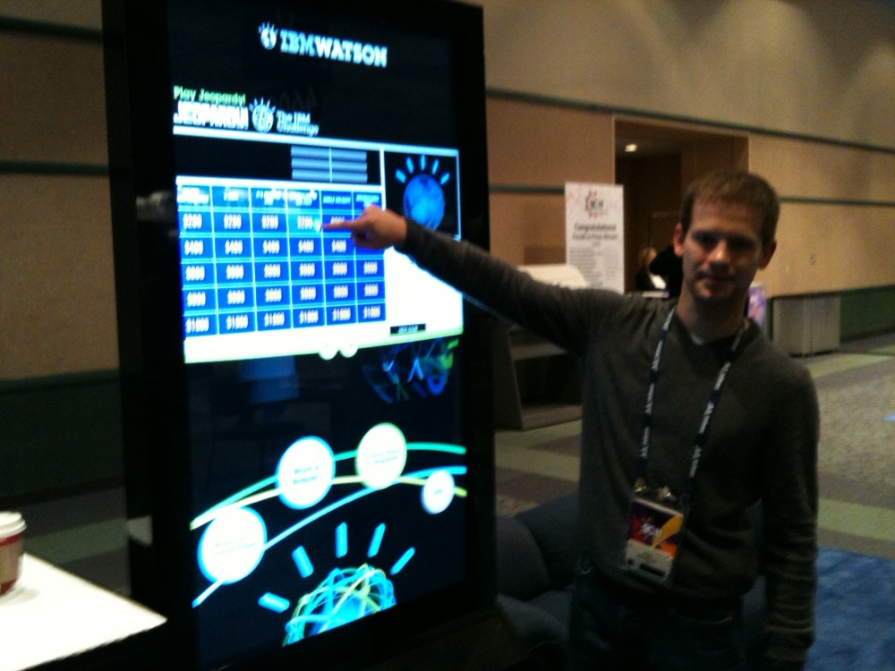

<p align="center">
  
</p>

<p align="center">
  <a href="https://cloudlabworks.dev"></a>
  <a href="https://linkedin.com/in/alexalvord"></a>
  <a href="mailto:alex@cloudlabworks.dev"></a>
  <a href="https://orcid.org/0009-0008-0614-1636"></a>
</p>

```text
$ whoami
alex.alvord      Advisory Solutions Architect, Hybrid Multicloud @ Nutanix
                 Seattle, WA · he/him · Duvall Lab · Cloud Lab Works LLC

$ cat /etc/motd
Focus and experience with disruptive technologies. Compute, network,
optimization, automation, and orchestration. Cloud-enabler.
Invisible Infrastructure.
```

## `> cat ~/maintainer`

| Project | What | Status |
|:--|:--|:--|
| [prove-it-done](https://github.com/issaquahd/prove-it-done) | An agent skill: nothing counts as done until a verifier re-checks the receipt |   |
| oak-events | Privacy-first events from Luxonis OAK cameras for AI agents, over MCP. No pictures leave the camera | coming soon |

## `> certs --matrix`

| Vendor | Foundational / Associate | Professional / Architect | Expert / Specialist |
|:--|:--|:--|:--|
| **Nutanix** |  |  |  |
| **AWS** |  |  | — |
| **Microsoft** |  | — | — |
| **IBM** | — |  | — |
| **Aviatrix** | — | — |  |
| **Dell Technologies** |  | — | — |

## `> ls ~/toolbox`

| | | | | | |
|:--:|:--:|:--:|:--:|:--:|:--:|
|  |  |  |  |  |  |

## `> cat memberships`

| | | |
|:--:|:--:|:--:|
|  |  |  |
|  |  |  |

## `> systemctl status alex`

| Unit | State |
|:--|:--|
| `working-on` | Hybrid multicloud with Nutanix NC2; upskilling; community involvement and mentoring. Ask me. |
| `learning` | Hybrid cloud networking, IaC, solutions architecting, AI and automation |
| `collaborate` | Anything open source |
| `wants-help-with` | AI / ML |
| `ask-me-about` | Cloud native, K8s, orchestration, automation, low code / no code |
| `reach` | alex@cloudlabworks.dev · alex.alvord@nutanix.com · [linkedin.com/in/alexalvord](https://linkedin.com/in/alexalvord) |
| `fun-fact` | We are all connected in this universe by a vibrational frequency, a field. My goal is to constantly tune and elevate my own vibrational frequency by making good with this Earth and its co-habitants. |

## `> ls -t ~/repos | head`

| Repo | What | Last push |
|:--|:--|:--|
| [cloudlabworks-site](https://github.com/issaquahd/cloudlabworks-site) | cloudlabworks.dev — site and blog, one Cloudflare Worker, no JS | 2026-09 |
| [azure-networking](https://github.com/issaquahd/azure-networking) | Layered and re-usable Azure designs and architectures | 2026-09 |
| [nc2azureazurevm](https://github.com/issaquahd/nc2azureazurevm) | NC2 on Azure — VM patterns | 2026-06 |
| [nc2costexplorer](https://github.com/issaquahd/nc2costexplorer) | NC2 cost exploration | 2026-05 |
| [NC2](https://github.com/issaquahd/NC2) | Musings over Nutanix NC2 | 2022-03 |

## `> history | grep 2011`

<p align="center">
  <br>
  <sub>Super Computing Conference 2011, Seattle WA — interacting with Watson by IBM, who stole the show that year.</sub>
</p>

<p align="center"><sub><code>$ exit</code> — there is no spoon.</sub></p>
